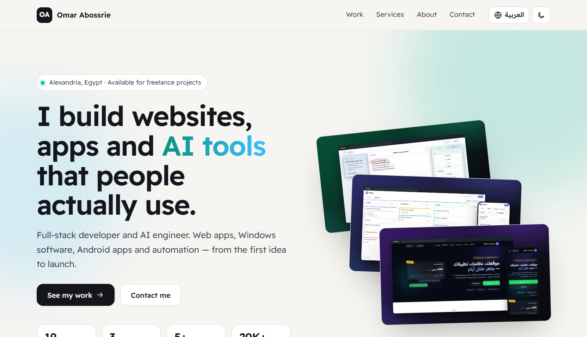
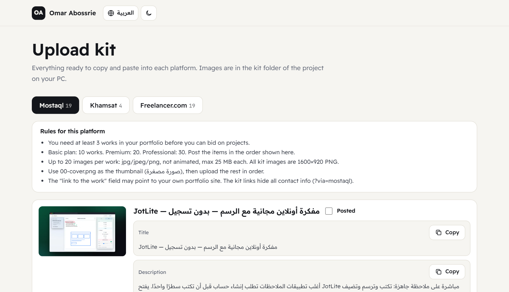

# BroPortfolio

**A bilingual (Arabic + English) portfolio website and a freelance-platform upload kit, built from one data file.**
Add a project, let it take the screenshots, and publish for free. Made for freelancers who sell on
[Mostaql](https://mostaql.com), [Khamsat](https://khamsat.com) and [Freelancer.com](https://www.freelancer.com).



## What you get

| | |
|---|---|
| **Portfolio website** | Arabic and English with a one-click switch (full right-to-left layout), light and dark themes, category filters, a page per project with a screenshot gallery and lightbox, link previews for WhatsApp/LinkedIn. Static files — works from disk, no framework. |
| **Upload kit** | For every project: a thumbnail and gallery images at **1600×920** (the exact shape Khamsat and Mostaql use), plus ready-to-paste **Arabic texts for Mostaql/Khamsat** and **English texts for Freelancer.com**. A kit page (`kit.html`) has a Copy button for every field and remembers what you already posted. |
| **Platform-safe links** | Links ending in `?via=mostaql`, `?via=khamsat` or `?via=freelancer` hide all contact details (the platforms forbid sharing them) and show a "Hire me on …" button instead. The build refuses platform texts that contain an e-mail, phone number or WhatsApp/Telegram link. |
| **Automatic screenshots** | Small JSON "recipes" drive a real browser through your web app — click, type, draw, switch to dark mode, open on a phone — and save the pictures. Ads and analytics are blocked, so screenshots never count as visits or ad views. Works for live sites, local apps, offline HTML files and even browser extensions. |
| **Free publishing** | One double-click publishes to **Cloudflare Pages** (free, no traffic limit). Firebase Hosting works too. |



## Quick start (Windows)

1. Install [Node.js](https://nodejs.org) 20 or newer.
2. Double-click **`Preview.bat`** — it installs the tools the first time, builds the site and opens it.
3. Edit **`content/profile.js`** (your name, services, contact) and **`content/projects.js`** (your work).
4. Double-click **`Add Project.bat`** to add a project with a few questions — if it has a live link, the screenshots are taken for you.
5. Double-click **`Publish.bat`** to put it online. The first time, log in once with `npx wrangler login`.

On macOS/Linux use the same commands: `npm install`, `npm run preview`, `npm run new`, `npm run deploy`.

## Adding a project by hand

1. Put screenshots in `content/media/<id>/` (any size — they are fitted to 1600×920 automatically).
2. Copy a block in `content/projects.js`, change the texts (each has `en` and `ar`), and list the images:

```js
images: [
  { file: 'home.png', caption: { en: 'Home page', ar: 'الصفحة الرئيسية' } },
  { files: ['phone-1.png', 'phone-2.png'], caption: { en: 'On a phone', ar: 'على الجوال' } }, // side by side
  { file: 'game.png', crop: true },          // trim a 16:9 picture to the kit shape
  { file: 'contact.png', khamsat: false }    // keep it out of the Khamsat bundles
],
cover: { main: 'home.png', phone: 'phone-1.png' }
```

3. Run `Preview.bat`. Set `hidden: true` to keep a project out without deleting it.

## Taking screenshots

- **Web apps** — write `content/capture/<id>.json` and run `node tools/shoot.mjs <id>`.
  A recipe has a `url`, optional `setup` steps (e.g. create demo data once), and a list of `shots`,
  each with `steps` such as `{"click": "text=Menu"}`, `{"fill": ["#title", "Hello"]}`, `{"keys": "…"}`,
  `{"mouse": [[x,y], …]}` (draw), `{"press": "Escape"}`, `{"eval": "…"}`, `{"wheel": ["#img", -120, 4]}`.
  Presets: `desktop` (1280 px wide, saved at 1600×920), `wide`, `xl`, `mobile` — or any `viewport`.
  `"extension": "<folder>"` loads an unpacked browser extension; `"serve": {"dir": "…"}` serves a local demo page.
  See the recipes in `content/capture/` for real examples.
- **Find selectors** — `node tools/probe.mjs <url>` lists every clickable element with its position and saves a screenshot.
- **Desktop apps (Windows)** — `tools/wincap.ps1` starts an app, resizes, clicks by name (UI Automation) and captures the window;
  `tools/redact.mjs` paints solid boxes over private details (never blur — blurred text can be recovered).

## Publishing

| | Free limits | Address |
|---|---|---|
| **Cloudflare Pages** (default) | no traffic limit | `https://<project>.pages.dev` |
| Firebase Hosting | 10 GB stored, 360 MB/day traffic | `https://<project>.web.app` |

`bro.config.json` chooses the target and project name. After the first publish, put the address in
`content/profile.js → siteUrl` and build again — the upload kit uses it for the "link to the work" field.

## Folder map

```
content/         YOUR DATA — profile.js, projects.js, media/<id>/ screenshots, capture/<id>.json recipes
web/             the site source (index.html, project.html, kit.html, assets/)
tools/           build, shoot, probe, serve, deploy, new-project, wincap.ps1, redact, alarm.ps1
dist/            generated website (publish this) — never edit by hand
kit/             generated upload kit — never edit by hand
docs/            architecture, change log, verified platform rules
```

## Use it for your own portfolio

Fork it, replace everything in `content/` with your own profile, projects and screenshots, and publish.

## License

The code (`web/`, `tools/`, the `.bat` files) is MIT. The portfolio content in `content/` (texts and
screenshots) belongs to Omar Abossrie and is not covered by the license.

---

## بالعربية — طريقة الاستخدام

**BroPortfolio** موقع معرض أعمال بالعربية والإنجليزية، مع «حقيبة رفع» جاهزة لمواقع مستقل وخمسات وفريلانسر.

1. ثبّت [Node.js](https://nodejs.org) (الإصدار 20 أو أحدث).
2. اضغط مرتين على **`Preview.bat`** لبناء الموقع وفتحه.
3. عدّل بياناتك في `content/profile.js` ومشاريعك في `content/projects.js` (لكل نص نسخة `en` إنجليزية و`ar` عربية).
4. لإضافة مشروع: اضغط **`Add Project.bat`** وأجب عن الأسئلة — وإذا كان للمشروع رابط مباشر تُلتقط الصور تلقائيًا.
5. للنشر المجاني: اضغط **`Publish.bat`**.

- **حقيبة الرفع** في مجلد `kit/` وفي صفحة `kit.html`: صور بمقاس 1600×920 ونصوص جاهزة مع زر «نسخ» لكل حقل.
- **روابط آمنة للمنصات**: أضف `?via=mostaql` أو `?via=khamsat` أو `?via=freelancer` إلى الرابط فتختفي كل وسائل التواصل،
  لأن هذه المنصات تمنع مشاركتها.
